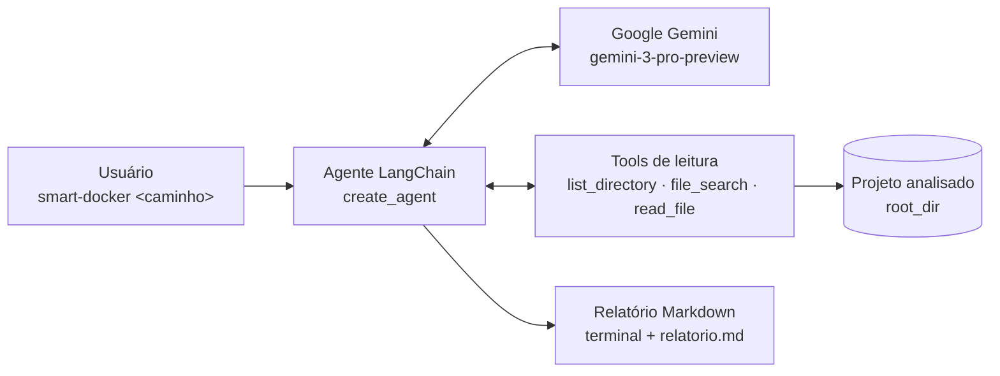

# SmartDocker

Agente de IA que analisa Dockerfiles de projetos de software, identificando problemas de segurança, performance e boas práticas. O agente investiga autonomamente a estrutura do projeto, identifica a linguagem e o framework utilizados e gera um relatório completo com os problemas encontrados e sugestões de correção.

> 🎥 Projeto prático do vídeo **[LangChain para DevOps](https://www.youtube.com/watch?v=B4atyr1BpSw)**.
>
> 🎓 Quer aprender a construir agentes como este e levá-los para produção? Conheça a **[Pós-Graduação em AIOps e IA na Engenharia de Cloud](https://pos.veronez.io/pos-aiops/)**.

## Como funciona

1. O agente lista os arquivos do projeto para entender a estrutura
2. Identifica a linguagem e o framework lendo arquivos de dependência
3. Localiza e lê o Dockerfile (e o `.dockerignore`, se existir)
4. Analisa o Dockerfile com base em 8 critérios de qualidade
5. Gera um relatório em Markdown com melhorias e um Dockerfile sugerido

## Arquitetura



## Como o agente decide

O SmartDocker não segue um roteiro fixo de código: quem decide o próximo passo é o modelo, por meio de **tool-calling**.

1. O **system prompt** (`src/prompt.py`) define o papel (especialista DevOps/Docker), os passos esperados, os critérios de análise e o formato exato do relatório.
2. O agente é criado com `create_agent` do LangChain (`src/app.py`), recebendo o LLM, as tools e o prompt.
3. A cada iteração, o modelo escolhe qual tool chamar e com quais argumentos: listar um diretório, procurar um arquivo ou ler seu conteúdo. O resultado volta para o modelo, que decide o passo seguinte.
4. O loop segue até o modelo ter contexto suficiente. Primeiro ele **entende o projeto** (linguagem, framework, porta da aplicação), depois **avalia o Dockerfile cruzando com esse entendimento**. É isso que permite, por exemplo, perceber que o `EXPOSE` não bate com a porta do código.

As tools vêm do `FileManagementToolkit` (`src/tools.py`) e são **somente leitura**, restritas ao diretório informado (`root_dir`). O agente não consegue escrever, apagar nem sair da pasta do projeto analisado.

## Critérios de análise

- **Imagem base**: compatibilidade com a linguagem/framework do projeto
- **Multi-stage build**: presente quando aplicável (Go, Java, TypeScript)
- **Cache de layers**: `COPY` de dependências antes do código-fonte
- **Usuário não-root**: instrução `USER` definida no Dockerfile
- **EXPOSE**: coerência com a porta real da aplicação
- **.dockerignore**: arquivo presente no projeto
- **Tamanho da imagem**: uso de variantes slim/alpine
- **Segurança**: sem secrets hardcoded, sem pacotes desnecessários

## Tecnologias

- **Python 3**
- **LangChain**: framework de agentes com tool-calling
- **Google Gemini 3 Pro (preview)**: LLM utilizado pelo agente (`gemini-3-pro-preview`)
- **FileManagementToolkit**: tools para leitura e busca de arquivos
- **Rich**: saída formatada no terminal

## Pré-requisitos

- Python 3.10+
- [uv](https://docs.astral.sh/uv/): gerenciador de pacotes Python
- Chave de API do Google Gemini

## Instalação

```bash
uv sync
```

Configure a variável de ambiente com sua chave de API:

```bash
cp .env.example .env
```

Edite o arquivo `.env` e adicione sua chave:

```
GOOGLE_API_KEY=sua-chave-aqui
```

## Uso

```bash
uv run smart-docker /caminho/do/projeto
```

Por padrão, o relatório é exibido no terminal e salvo em `relatorio.md` **na raiz do SmartDocker** (não no projeto analisado). Para escolher outro arquivo de saída:

```bash
uv run smart-docker /caminho/do/projeto -o meu-relatorio.md
```

Ou execute diretamente:

```bash
uv run python src/app.py /caminho/do/projeto
```

### Testando com o projeto de exemplo

O repositório inclui uma API Node.js em `examples/node-api` com um Dockerfile **cheio de problemas de propósito**: imagem `latest`, secret hardcoded, cache de layers quebrado, execução como root, `EXPOSE` diferente da porta real e ausência de `.dockerignore`.

```bash
uv run smart-docker examples/node-api
```

## Exemplo de saída

O relatório gerado segue esta estrutura:

- **Resumo do Projeto**: linguagem, framework, estrutura de pastas e dependências
- **Melhorias**: cada item com severidade (crítica, alta, média ou baixa), descrição e trecho de Dockerfile sugerido
- **Dockerfile Sugerido**: versão completa aplicando todas as melhorias
- **Nota Geral**: "adequado", "adequado com ressalvas" ou "precisa de ajustes", com justificativa

<details>
<summary>Ver trecho de relatório para o <code>examples/node-api</code> (ilustrativo)</summary>

> Exemplo ilustrativo, escrito no formato que o agente produz. Como a saída vem de um LLM, o relatório real pode variar em texto e quantidade de itens.

````markdown
# Relatório de Análise Docker

## Resumo do Projeto
API REST em Node.js com Express, entrypoint em `src/index.js`, escutando na porta 3000
(variável `PORT`). Dependência principal: `express`.

## Melhorias

### 1. Secret hardcoded no Dockerfile
- **Severidade**: crítica
- **Descrição**: `ENV API_KEY=...` grava a chave na imagem e no histórico de layers.
  Qualquer pessoa com acesso à imagem consegue lê-la.
- **Trecho sugerido**:
```dockerfile
# Remova a linha ENV API_KEY e injete em tempo de execução:
# docker run -e API_KEY=... minha-imagem
```

### 2. EXPOSE diferente da porta da aplicação
- **Severidade**: média
- **Descrição**: o Dockerfile expõe a porta 8080, mas a aplicação escuta na 3000.
- **Trecho sugerido**:
```dockerfile
EXPOSE 3000
```

## Nota Geral
**Precisa de ajustes**: há um secret exposto na imagem, o container roda como root,
o cache de dependências é invalidado a cada mudança de código e falta `.dockerignore`.
````

</details>

## Limitações

- **Análise estática**: o agente só lê arquivos. Ele não faz build da imagem, não a executa e não roda scanners de vulnerabilidade.
- **Um Dockerfile por análise**: o foco é o Dockerfile do projeto. `docker-compose.yml` e múltiplos Dockerfiles não são avaliados de forma dedicada.
- **Dependência do Gemini**: exige uma chave de API do Google, e o modelo está fixo em `src/app.py`.
- **Saída não determinística**: por ser baseado em LLM, duas execuções podem gerar relatórios diferentes. Revise as sugestões antes de aplicá-las.

## Estrutura do projeto

```
.
├── docs/
│   ├── ESPECIFICACAO.md  # Especificação técnica detalhada
│   └── PRD.md            # Product Requirements Document
├── examples/
│   └── node-api/         # API Node.js com Dockerfile problemático para testes
├── src/
│   ├── __init__.py       # Inicializador do pacote
│   ├── app.py            # Ponto de entrada e orquestração do agente
│   ├── prompt.py         # System prompt com instruções de análise
│   └── tools.py          # Configuração das tools do agente
├── .env.example          # Template de variáveis de ambiente
├── pyproject.toml        # Configuração do projeto e dependências
├── uv.lock               # Lock file com versões exatas
└── README.md             # Este arquivo
```

## Aprenda mais: Pós-Graduação em AIOps e IA na Engenharia de Cloud

**Aprenda a trabalhar com IA em Cloud e DevOps. Do fundamento à produção.**

O SmartDocker é uma amostra do que é construído na pós: o módulo **Agentes e Automações com IA** aprofunda agentes e automações com LangChain, e o módulo **Containers e Orquestração com IA** leva a IA para o dia a dia com Docker e Kubernetes.

Disciplinas:

1. Fundamentos de IA
2. Engenharia de Prompt e Contexto
3. Agentes e Automações com IA
4. Containers e Orquestração com IA
5. Infraestrutura Cloud, IaC e Arquitetura com IA
6. DevOps, SRE e AIOps
7. Posicionamento Estratégico e Liderança Técnica

Certificado reconhecido pelo MEC, emitido em parceria com a Faculdade FC Tech.

👉 **[Conheça a pós](https://pos.veronez.io/pos-aiops/)**

## Autor

**Fabrício Veronez**: Microsoft MVP, Docker Captain e AWS Community Builder.
